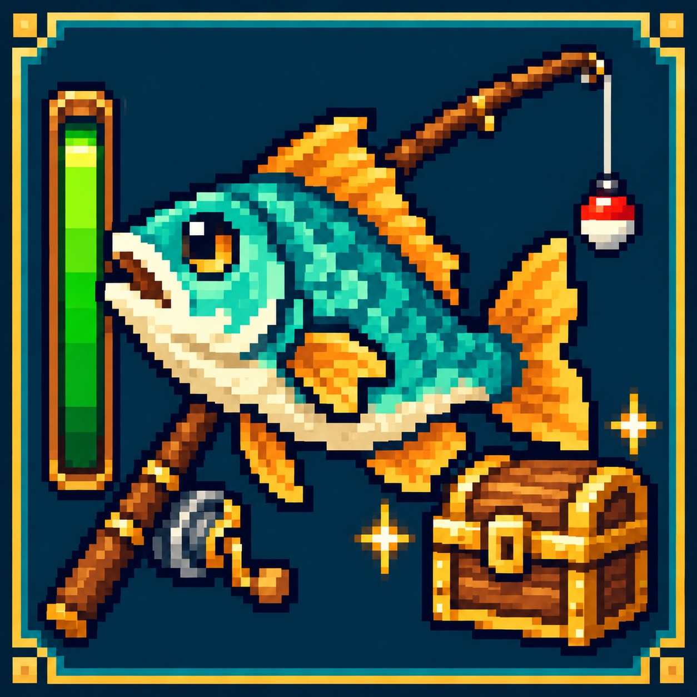

# 星露谷自动钓鱼（Stardew Fishing Autofish）

[Curseforge](https://www.curseforge.com/minecraft/mc-mods/stardewfishingautofish)|[Github](https://github.com/lichao10/StardewFishingAutofish)

## 中文

适用于 **Stardew Fishing 3.7** 的客户端自动钓鱼辅助模组，支持自动抛竿、咬钩收竿、小游戏控制和宝箱优先。服务端无需安装本辅助模组。

| Minecraft | 加载器 | 游戏 Java | 必需的 Stardew Fishing 文件 |
|---|---|---|---|
| 1.20.1 | Forge 47.4.0（47.x） | 17 | 3.7 / Forge 1.20.1（`UgWzAtGu`） |
| 1.21.1 | NeoForge 21.1.197 起的 21.1.x | 21 | 3.7 / NeoForge 1.21.1（`iJkNXCRB`） |

按游戏版本和加载器选择一个安装包，放入对应实例的 `mods` 目录。两个安装包分别运行，不能互换。

1. 手持鱼竿、面向可钓鱼的水面，按 **F8** 开启，再按一次关闭。
2. 出现宝箱时会优先充满宝箱进度，并尽量保持鱼不脱钩，随后钓上鱼；结算后自动继续抛竿。较难的鱼仍可能逃脱。
3. 开启后可切换到其他窗口或最小化游戏。切后台前请关闭背包、聊天框和 Esc 菜单；关闭自动钓鱼后恢复原来的失焦暂停设置。

**1.4.0 升级说明：** MOD ID 已由 `sunlit_autofish` 改为 `stardewfishingautofish`。升级前移除旧版 JAR（包括 SunlitAutoFish），避免同时加载；自定义快捷键需重新设置，默认仍为 F8。

开发者在当前目录执行 `.\gradlew.bat build` 构建并验证全部目标，执行 `.\gradlew.bat collectArtifacts` 将已验证的安装包与校验文件汇总到 `build/releases/`。也可通过 `'-Ptarget=forge-1.20.1'` 或 `'-Ptarget=neoforge-1.21.1'` 单独构建。Gradle 使用 JDK 21，Forge 编译另需 JDK 17。

源码采用根目录 `common/`、`forge/`、`neoforge/` 与 `buildSrc/` 布局。本机执行 `.\gradlew.bat publishLocal` 将验证后的版本整理到 `D:\MODS\StardewFishingAutofish\1.4.0`，无需手动复制安装包。

[工程结构、分支与标签、多版本接入](docs/MULTIVERSION.md) · [本次验证结果](docs/VALIDATION.md) · [更新日志](CHANGELOG.md)

---

## English

A client-side automation addon for **Stardew Fishing 3.7**, featuring automatic casting, bite detection, minigame control and treasure prioritization. Separate builds target **Minecraft 1.20.1 Forge / Java 17** and **Minecraft 1.21.1 NeoForge / Java 21**. Install the matching upstream 3.7 file and addon JAR on the client; the server does not need this addon.

1. Hold a fishing rod, face fishable water and press **F8** to enable automation.
2. When treasure appears, the controller prioritizes charging it while trying to keep the fish hooked, then lands the fish. Fishing repeats after settlement. Difficult fish may still escape.
3. Switch windows or minimize Minecraft while enabled. Close inventory, chat and Esc menus first. The previous pause-on-lost-focus setting is restored when automation stops.

Version 1.4.0 changes the MOD ID to `stardewfishingautofish`. Remove the old JAR before upgrading and rebind custom keys if needed. F8 remains the default.

Run `./gradlew build` for all targets, or add `'-Ptarget=forge-1.20.1'` / `'-Ptarget=neoforge-1.21.1'`. `collectArtifacts` collects verified JARs, sources and checksums in `build/releases/`. Build Gradle with JDK 21 and provide a JDK 17 toolchain for Forge. See the linked maintenance and validation notes for verified scope and remaining in-game checks.
